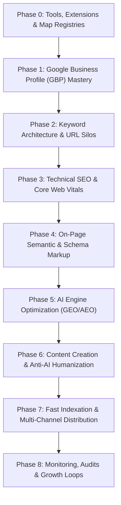

  <h1 align="center">🚀 Universal SEO Master Checklist & Execution Blueprint</h1>
  

    <strong>The battle-tested, step-by-step SEO & GEO framework for any modern web project.</strong> 
    Covering Technical SEO, Local SEO (GBP, Apple Maps, Bing, HERE GPS), On-Page Semantic Schema, and Generative Engine Optimization (GEO / AEO for ChatGPT, Perplexity, Claude, Gemini).
  

  
  
  
  
  

---

## 📌 Table of Contents

- [Overview & Purpose](#-overview--purpose)
- [Master SEO Roadmap Flowchart](#-master-seo-roadmap-flowchart)
- [Phase 0: Tooling, Audit Extensions & Map Registries](#phase-0-tooling-audit-extensions--map-registries)
- [Phase 1: Google Business Profile (GBP) & Local SEO Mastery](#phase-1-google-business-profile-gbp--local-seo-mastery)
- [Phase 2: Keyword Architecture & URL Silo Design](#phase-2-keyword-architecture--url-silo-design)
- [Phase 3: Technical SEO & Core Web Vitals](#phase-3-technical-seo--core-web-vitals)
- [Phase 4: On-Page Semantic & Schema.org Markup](#phase-4-on-page-semantic--schemaorg-markup)
- [Phase 5: AI Engine & Generative Engine Optimization (GEO / AEO)](#phase-5-ai-engine--generative-engine-optimization-geo--aeo)
- [Phase 6: Content Creation & Anti-AI Humanization](#phase-6-content-creation--anti-ai-humanization)
- [Phase 7: Fast Indexation & Multi-Channel Distribution](#phase-7-fast-indexation--multi-channel-distribution)
- [Phase 8: Monitoring, Audits & Growth Loops](#phase-8-monitoring-audits--growth-loops)
- [🧰 Master SEO Tool Stack & Resources](#-master-seo-tool-stack--resources)
- [📚 Official Documentation & Standards](#-official-documentation--standards)
- [Contributing](#contributing)
- [License](#license)

---

## 🎯 Overview & Purpose

Modern search engine visibility requires more than just legacy keyword stuffing. In **2026**, dominating search rankings requires an integrated approach spanning:
1. **Traditional Technical & On-Page SEO:** SSR/SSG rendering, sub-second Core Web Vitals, and strict Schema.org JSON-LD.
2. **Multi-Platform Local Ecosystems:** Google Business Profile, Apple Maps, Bing Places, and in-car automotive navigation (HERE Map Creator).
3. **Generative Engine Optimization (GEO / AEO):** Formatting site data (`llms.txt`, concise definitions, and high-information-gain statistics) so **ChatGPT, Perplexity, Claude, and Gemini** cite your brand in answer engines.

Use this checklist as your primary SOP whenever launching a new client website, SaaS platform, e-commerce store, or content publication.

---

## 🧭 Master SEO Roadmap Flowchart

---

## 📋 Actionable Checklist

### Phase 0: Tooling, Audit Extensions & Map Registries
- [ ] **Install GBP Audit Extensions:**
  - [ ] **[GMB Crush](https://www.gmbcrush.com/):** Install extension for fast Google Business Profile competitor analysis, category benchmarking, and local grid tracking.
  - [ ] **Phantom:** Install extension for GMB listing verification and deep profile auditing.
- [ ] **Image Geotagging Tool:**
  - [ ] Bookmark **[GeoImgr](https://tool.geoimgr.com/)** for injecting high-precision GPS coordinates, EXIF keywords, and IPTC business metadata into images before upload.
- [ ] **Search Engine Webmaster Verification:**
  - [ ] **Google Search Console (GSC):** Verify domain property via DNS TXT record.
  - [ ] **Bing Webmaster Tools:** Connect and sync directly with GSC.
  - [ ] **IndexNow:** Generate an API key and configure automated instant-ping endpoint for real-time indexing.
- [ ] **Multi-Platform Map & Local Registries (Universal NAP):**
  - [ ] **Google Business Profile (GBP):** Claim, verify, and complete 100% of profile fields.
  - [ ] **Bing Places for Business:** 1-click sync with Google Business Profile to keep NAP (Name, Address, Phone) identical.
  - [ ] **Apple Business Connect:** Register and claim location for Apple Maps, Siri voice search, and Spotlight.
  - [ ] **HERE Map Creator:** Add & verify business POI for in-car GPS navigation systems (Audi, BMW, Mercedes, Garmin).

---

### Phase 1: Google Business Profile (GBP) & Local SEO Mastery
- [ ] **Profile Naming:** Add primary target keywords to the official profile name where compliant with guidelines.
- [ ] **Primary & Secondary Categories:** Verify that the primary business category is 100% accurate, and add all relevant secondary categories.
- [ ] **Cover & Storefront Photos:** Upload a professional, high-resolution cover photo representing the storefront, office, or physical workspace.
- [ ] **Image Naming Protocol:** Rename all image files to include target keywords and brand name before upload (e.g., `[brand]-[primary-keyword]-[service]-[city].jpg`).
- [ ] **GBP File Format Rule:** ⚠️ Google Business Profile does **NOT** accept WebP. Always upload high-res **JPG** (`.jpg`) with embedded GPS/IPTC metadata.
- [ ] **Ongoing Photo & Video Publishing:** Continuously upload new photos and short video clips to keep profile engagement active.
- [ ] **Services & Products Dual-Listing:**
  - Inject target keywords into all listed **Services**.
  - Duplicate each service as an individual **Product** card with an image, description, price, and CTA link.
- [ ] **Daily Google Updates:** Publish an everyday Google Update post featuring:
  - High-res landscape image (`1200x900` JPG).
  - Concise service description packed with target keywords.
  - Clear Action CTA button ("Learn more", "Call now", or "Book").
- [ ] **Review Management & SEO Keyword Replies:**
  - Reply to **100% of reviews manually** using target keywords in your responses (avoid generic AI replies).
  - Encourage authentic **rich reviews** with customer photos attached.
- [ ] **Security & Listing Ownership:** Regularly monitor the connected email to protect against unauthorized ownership claims or malicious edits.
- [ ] **Google Preferred Sources:** Add Google's [Preferred Sources](https://developers.google.com/search/docs/appearance/preferred-sources) markup/button to your website to boost visibility in Top Stories and AI Overviews.

---

### Phase 2: Keyword Architecture & URL Silo Design
- [ ] **Keyword Clustering:** Map 1 Primary Keyword + 4–6 Secondary/LSI keywords per URL.
- [ ] **Search Intent Alignment:**
  - *Informational* &rarr; Blog / Guide / Educational Article.
  - *Commercial / Comparison* &rarr; Alternative / Vs. Page / Feature Breakdown.
  - *Transactional* &rarr; Service Page / Product (PDP) / Pricing.
- [ ] **Clean URL Hierarchy:**
  - Lowercase kebab-case (`/services/web-development`, `/blog/seo-guide`).
  - Max depth: $\le 3$ levels (`domain.com/category/subfolder/slug`).
  - No dates, no stop words, consistent trailing slash enforcement.

---

### Phase 3: Technical SEO & Core Web Vitals
- [ ] **SSR / SSG / Pre-Rendering:** Guarantee 100% server-rendered HTML (zero empty DOM crawler traps for Googlebot/AI bots).
- [ ] **Core Web Vitals Benchmarks:**
  - **LCP (Largest Contentful Paint):** $\le 2.5\text{s}$ (preload hero asset, use WebP).
  - **INP (Interaction to Next Paint):** $\le 200\text{ms}$ (lean JS, optimized island hydration).
  - **CLS (Cumulative Layout Shift):** $\le 0.1$ (explicit aspect ratios on all media/iframes).
- [ ] **Robots.txt & Sitemap:**
  - `robots.txt` allowing search crawlers and AI bots (GPTBot, ClaudeBot, PerplexityBot).
  - Dynamic `sitemap.xml` listing only 200-OK canonical URLs.
- [ ] **Canonical & Multilingual Tags:**
  - Self-referencing `<link rel="canonical" href="...">` on all primary pages.
  - Accurate `hreflang` tags (`de-DE`, `en-US`, `x-default`) for multi-language platforms.
- [ ] **Security & Error Handling:** Enforce HTTPS, HSTS, secure headers, and clean custom 404.

---

### Phase 4: On-Page Semantic & Schema.org Markup
- [ ] **Title Tag:** Primary Keyword in the first 40 characters (`Primary Keyword – Context | Brand`, 50–60 chars total).
- [ ] **Meta Description:** Engaging summary with primary keyword + clear CTA (120–155 chars).
- [ ] **Heading Hierarchy:**
  - Exactly **one `<h1>`** containing the primary target keyword.
  - Clear, structured `<h2>` and `<h3>` tags mapping related search queries.
- [ ] **Keyword Highlighting & Density:**
  - Primary keyword in first 100 words.
  - Highlight key terms (`**keyword**`) for scannability.
  - Natural keyword presence in at least two `<h2>` headings and conclusion.
- [ ] **Schema.org Structured Data (JSON-LD):**
  - [ ] `Organization` / `LocalBusiness` (with address, geo-coordinates, logo, sameAs links).
  - [ ] `WebSite` with `SearchAction` (internal search).
  - [ ] `BreadcrumbList` (on all subpages).
  - [ ] `Article` / `BlogPosting` (author, datePublished, dateModified).
  - [ ] `Product` + `Offer` + `AggregateRating` (e-commerce/services).
  - [ ] `FAQPage` (for accordion Q&A sections).
- [ ] **Image SEO & Web Optimization:**
  - Convert all website images to **WebP**.
  - Naming convention: `[brand]-[primary-keyword]-[context].webp`.
  - Keyword-rich descriptive `alt` text on every image.

---

### Phase 5: AI Engine & Generative Optimization (GEO / AEO)
- [ ] **LLM Knowledge Bundle (`llms.txt`):** Deploy `/llms.txt` and `/llms-full.txt` at domain root detailing company capabilities, docs, and entity relations per the [llms.txt standard](https://llmstxt.org/).
- [ ] **Direct Answer Structuring:** Add concise 2-sentence summary callouts directly beneath headings for instant AI answer extraction.
- [ ] **High-Information Gain:** Include original comparison tables, verified statistics, and bulleted key takeaways that LLMs cite as authoritative proof.

---

### Phase 6: Content Creation & Anti-AI Humanization
- [ ] **Business Alignment:** Blog and article topics must be strictly related to the core business and service offerings.
- [ ] **Word Count Splitting Rule:** If a blog draft reaches or exceeds **1,000 words**, split it into a 2-part series to maintain deep topical focus.
- [ ] **Content Layout & Formatting:**
  - Compelling introduction and auto-generated Table of Contents.
  - Clear H1 and scannable H2/H3 hierarchy.
  - Main cover image, featured images, and inline visuals breaking up paragraphs.
- [ ] **Tone Humanization:** Eliminate robotic AI clichés (*"delve", "tapestry", "in conclusion", "furthermore", "leverage"*).
- [ ] **Quality Assurance:** Perform strict plagiarism and paraphrase checks before publishing.
- [ ] **Linking Standards:**
  - **3–5 Internal Links** pointing to related services/articles with descriptive anchors.
  - **2–3 External Authority Links** pointing to Tier 1 sources.
  - Include a dedicated **References & Sources** section at the bottom.

---

### Phase 7: Multi-Channel Distribution & Community Engagement
- [ ] **Instant IndexNow Ping:** Push URL immediately upon publish to Bing, Yandex, and Seznam.
- [ ] **GSC URL Inspection:** Request manual indexing in Google Search Console.
- [ ] **Developer & Tech Platform Syndication:** Republish articles on **Medium**, **Dev.to**, and **Hashnode** with original `rel="canonical"` backlink.
- [ ] **Community & Forum Promotion:**
  - Create high-value, educational posts on **Reddit** and **Quora** with links back to the blog.
  - Monitor Reddit/Quora threads daily and actively engage in the comments.
- [ ] **Daily GBP Update:** Post the new content as a Google Business Update with image, summary, and link CTA.

---

### Phase 8: Monitoring, Audits & Growth Loops
- [ ] **Weekly GSC Performance Audit:** Track Impression spikes, CTR improvements, and optimize queries ranking in positions 4–15.
- [ ] **Quarterly Crawl Audit:** Run Screaming Frog / Ahrefs audits to fix 404s, broken internal links, and canonical drift.
- [ ] **Content Decay Updating:** Refresh statistics, dates, and outdated links on top evergreen articles every 6 months.

---

## 🧰 Master SEO Tool Stack & Resources

| Tool | Category | Purpose | Official Link |
|---|---|---|---|
| **GMB Crush** | Local / GBP | Competitor GBP audits & local rank tracking | [gmbcrush.com](https://www.gmbcrush.com/) |
| **GeoImgr** | Local / EXIF | GPS coordinate & IPTC image geotagging | [tool.geoimgr.com](https://tool.geoimgr.com/) |
| **Google Search Console** | Technical | Indexation, sitemaps & search queries | [search.google.com](https://search.google.com/search-console) |
| **Bing Webmaster Tools** | Technical | Indexing, SEO reports & GSC sync | [bing.com/webmasters](https://www.bing.com/webmasters) |
| **IndexNow** | Technical | Instant real-time URL push protocol | [indexnow.org](https://www.indexnow.org/) |
| **Apple Business Connect** | Local / Maps | Apple Maps, Siri, and Spotlight listings | [businessconnect.apple.com](https://businessconnect.apple.com/) |
| **Bing Places** | Local / Maps | Bing Maps business directory (GBP sync) | [bingplaces.com](https://www.bingplaces.com/) |
| **HERE Map Creator** | In-Car GPS | Navigation POI (Mercedes, BMW, Audi, Garmin) | [mapcreator.here.com](https://mapcreator.here.com/) |
| **Schema Validator** | Structured Data | JSON-LD syntax & schema validation | [validator.schema.org](https://validator.schema.org/) |
| **Rich Results Test** | Structured Data | Google rich snippet eligibility test | [search.google.com/test/rich-results](https://search.google.com/test/rich-results) |
| **PageSpeed Insights** | Web Vitals | Core Web Vitals (LCP, INP, CLS) performance | [pagespeed.web.dev](https://pagespeed.web.dev/) |

---

## 📚 Official Documentation & Standards

- 📖 **Google Search Central:** [SEO Starter Guide](https://developers.google.com/search/docs/fundamentals/seo-starter-guide)
- 📖 **web.dev:** [Core Web Vitals Documentation](https://web.dev/explore/fast)
- 📖 **Schema.org:** [Full Structured Data Hierarchy](https://schema.org/docs/documents.html)
- 📖 **IndexNow Protocol:** [API Documentation](https://www.indexnow.org/documentation)
- 📖 **llms.txt Proposal:** [The llms.txt Standard for AI Search](https://llmstxt.org/)
- 📖 **Google Search Central:** [Google Preferred Sources](https://developers.google.com/search/docs/appearance/preferred-sources)

---

## 🔗 Sister Open-Source Projects

- ⚡ **[Awesome AI & Developer Stack](https://github.com/masrisystems/awesome-ai-developer-stack):** Curated directory of 120+ AI agents, MCP servers, portable skills, and developer tools.
- 🤖 **[Dot Agents Config (.agents)](https://github.com/masrisystems/dot-agents):** Universal multi-agent configuration, skills catalog, and 1-line cross-platform installers.

## Contributing

Contributions, issues, and feature requests are welcome! Feel free to open a PR or submit an issue.

## License

Distributed under the Masri Systems Non-Commercial Source-Available License (MS-NC-1.1). See [LICENSE](LICENSE) for details. Personal and academic use only; business and commercial environments are prohibited without a separate commercial license (`hallo@masrisystems.com`).
